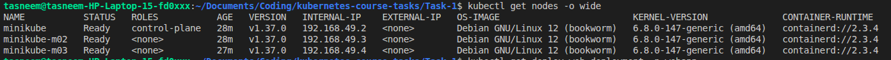
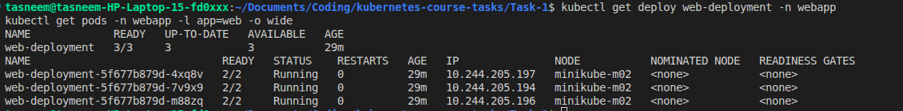
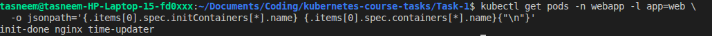
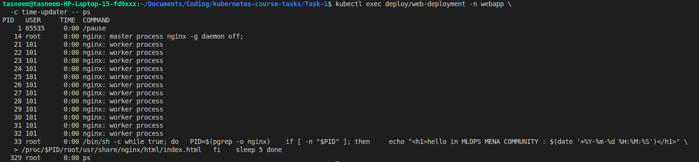
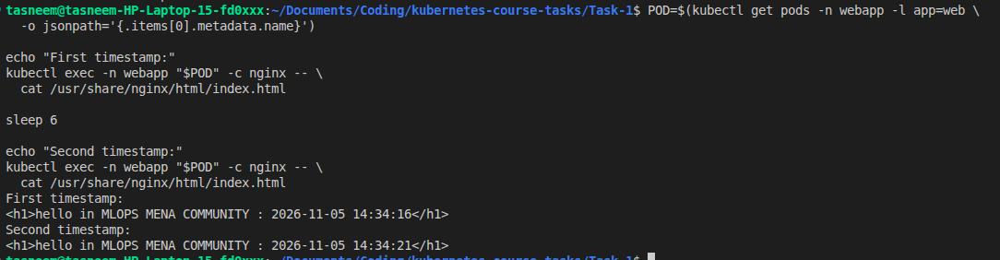
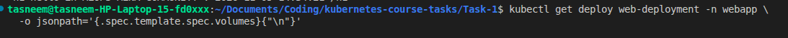
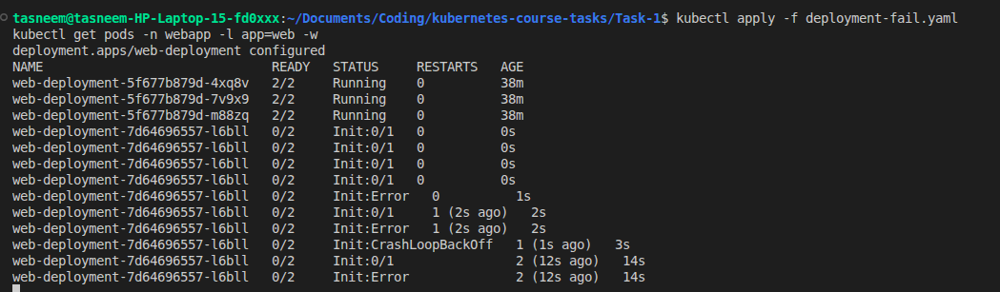
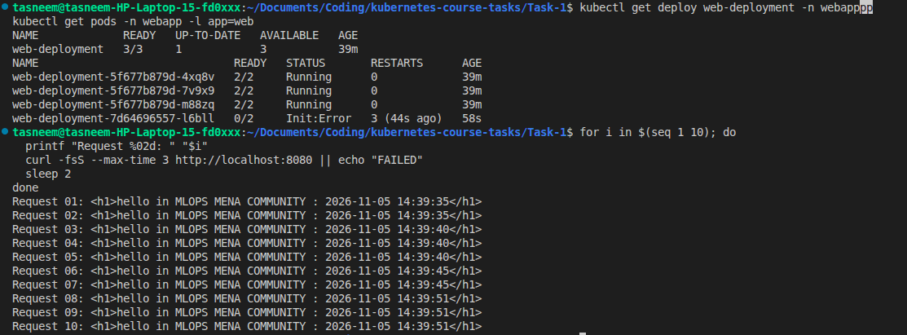
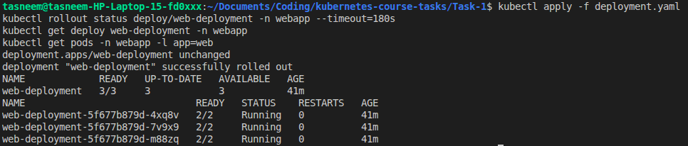

# Multi-Container Pods (Init Container & Sidecar)

## 1. Objective

Deploy an Nginx web application on a **3-node Minikube cluster** using a multi-container Pod architecture.

The application displays the current timestamp, which is automatically updated every 5 seconds by a sidecar container.

This task demonstrates:

- Kubernetes init containers and sidecar containers.
- Shared process namespaces between containers.
- Accessing another container's filesystem through `/proc/<pid>/root`.
- Updating files without declaring shared volumes.
- Kubernetes Pod lifecycle, failure handling, and Deployment recovery.
- Maintaining application availability during a failed rolling update.

## 2. Cluster Setup

The Kubernetes cluster consists of one control-plane node and two worker nodes.

Minikube was configured with the Docker driver and Calico CNI.

```bash
minikube start \
  --driver=docker \
  --nodes=3 \
  --cni=calico \
  --cpus=2 \
  --memory=2200
```

Verify the cluster:

```bash
kubectl get nodes -o wide
```

### Cluster nodes



## 3. Application Architecture

Each Pod contains three containers:

| Container | Type | Responsibility |
|---|---|---|
| `init-done` | Init container | Prints `done` and exits successfully |
| `nginx` | Main container | Creates and serves the initial HTML page |
| `time-updater` | Sidecar container | Updates the HTML timestamp every 5 seconds |

The application uses:

- **Namespace:** `webapp`
- **Deployment:** `web-deployment`
- **Replicas:** 3
- **Pod label:** `app: web`
- **Images:** `busybox:1.36`, `nginx:1.27`
- **Web server port:** 80
- **Process sharing:** `shareProcessNamespace: true`

The sidecar finds the Nginx process using `pgrep -o nginx` and accesses its HTML file through:

```text
/proc/<nginx-pid>/root/usr/share/nginx/html/index.html
```

The sidecar has the `SYS_PTRACE` capability to support process inspection. No shared volumes are declared.

## 4. Deployment

Create the namespace:

```bash
kubectl create namespace webapp
```

Deploy the application:

```bash
kubectl apply -f deployment.yaml
```

Verify the Deployment and Pods:

```bash
kubectl get deploy web-deployment -n webapp
kubectl get pods -n webapp -l app=web -o wide
```

The expected healthy state is:

- Deployment: `3/3` available replicas.
- Three application Pods: `2/2 Running`.

The init container does not count toward the `2/2` ready containers because it has already completed.

### Running Pods



## 5. Container Verification

Verify that each Pod includes the correct containers:

```bash
kubectl get pods -n webapp -l app=web \
  -o jsonpath='{.items[0].spec.initContainers[*].name} {.items[0].spec.containers[*].name}{"\n"}'
```

Expected output:

```text
init-done nginx time-updater
```

### Container names



## 6. Init Container Verification

The `init-done` container runs before the Nginx and time-updater containers.

Its command is:

```yaml
command: ["sh", "-c", "echo done"]
```

Check the logs:

```bash
kubectl logs deploy/web-deployment -n webapp -c init-done
```

Expected output:

```text
done
```

The successful exit code is `0`, allowing the application containers to start.

### Successful initialization


## 7. Shared Process Namespace

The Pod uses:

```yaml
shareProcessNamespace: true
```

This allows the sidecar to discover the Nginx process even though Nginx is running in a different container.

Verify process visibility:

```bash
kubectl exec deploy/web-deployment -n webapp \
  -c time-updater -- ps
```

The process list should include the Nginx master process.

### Shared process verification



## 8. Timestamp Updates

The Nginx container writes the initial HTML file using the current timestamp:

```html
<h1>hello in MLOPS MENA COMMUNITY : 2026-10-15 10:15:05</h1>
```

The timestamp above is an example.

The sidecar updates the same file every 5 seconds through the Nginx process's root filesystem.

Verify the timestamp:

```bash
kubectl exec deploy/web-deployment -n webapp \
  -c nginx -- cat /usr/share/nginx/html/index.html
```

Repeat the command after 5 seconds and compare the timestamps.

To access the application through a browser:

```bash
kubectl port-forward -n webapp deploy/web-deployment 8080:80
```

Open:

http://localhost:8080

Refresh the page after 5 seconds to see the updated timestamp.

### Timestamp verification



## 9. No Shared Volumes

The task requires accessing Nginx's filesystem without declaring Kubernetes volumes.

Verify:

```bash
kubectl get deploy web-deployment -n webapp \
  -o jsonpath='{.spec.template.spec.volumes}{"\n"}'
```

Expected output: empty.

The sidecar accesses the file through `/proc/<pid>/root` rather than a shared `volumeMount`.

### Volume verification



## 10. Failure Experiment — Init:CrashLoopBackOff

To observe Kubernetes failure handling, a second manifest, `deployment-fail.yaml`, intentionally changes the init container command to:

```yaml
command: ["sh", "-c", "echo 'init failed'; exit 1"]
```

Apply the failing version:

```bash
kubectl apply -f deployment-fail.yaml
```

Observe the Pods:

```bash
kubectl get pods -n webapp -l app=web -w
```

The new Pod is expected to enter `Init:Error`, followed by `Init:CrashLoopBackOff` after repeated failed initialization attempts.

Inspect its logs:

```bash
kubectl logs <failing-pod-name> -n webapp -c init-done
```

Inspect its details:

```bash
kubectl describe pod <failing-pod-name> -n webapp
```

The init container exits with code `1`.

Because initialization fails, the new Pod's `nginx` and `time-updater` containers do not start.

### Failure diagnosis



## 11. Availability During the Failed Rollout

The Deployment uses the following rolling update strategy:

```yaml
strategy:
  type: RollingUpdate
  rollingUpdate:
    maxUnavailable: 0
    maxSurge: 1
```

This allows Kubernetes to create one additional Pod during an update without intentionally removing the existing three healthy replicas until replacements are available.

When the new Pod fails initialization, the old healthy Pods should continue serving the Nginx application.

Verify:

```bash
kubectl get deploy web-deployment -n webapp
kubectl get pods -n webapp -l app=web
```

Test HTTP availability while the failure is present:

```bash
for i in $(seq 1 10); do
  curl -fsS --max-time 3 http://localhost:8080
  sleep 2
done
```

Successful requests during the failure demonstrate that the existing replicas remained available in this experiment.

### Availability verification



## 12. Recovery

Restore the successful init container by reapplying the working Deployment:

```bash
kubectl apply -f deployment.yaml
```

Wait for reconciliation:

```bash
kubectl rollout status deploy/web-deployment -n webapp --timeout=180s
```

Verify the recovery:

```bash
kubectl get deploy web-deployment -n webapp
kubectl get pods -n webapp -l app=web
```

The expected final state is:

- Deployment: `3/3` ready.
- Three Pods: `2/2 Running`.
- The failing Pod is removed.
- Nginx continues serving updated timestamps.

### Recovery verification



## 13. Key Takeaways

1. Init containers must complete successfully before regular application containers can start.
2. A failing init container is retried with backoff and can cause `Init:CrashLoopBackOff`.
3. With `shareProcessNamespace: true`, containers in one Pod can inspect each other's processes.
4. The sidecar can update Nginx's filesystem through `/proc/<pid>/root` without declaring shared volumes.
5. Multiple replicas and a suitable rolling update strategy can preserve application availability during a failed update.
6. Restoring the working manifest allows Kubernetes to reconcile the Deployment back to its desired healthy state.

## 14. Cleanup

The cluster can be reused for the next course tasks.

To remove only this assignment:

```bash
kubectl delete namespace webapp
```

To stop Minikube without deleting the cluster:

```bash
minikube stop
```
