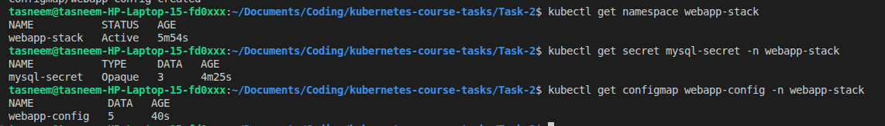
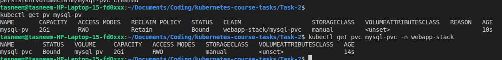
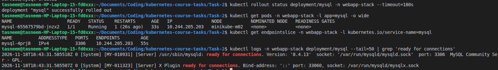
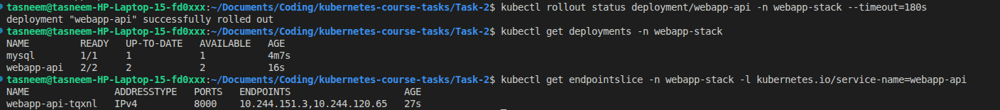
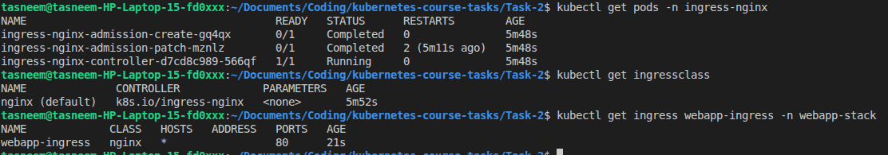
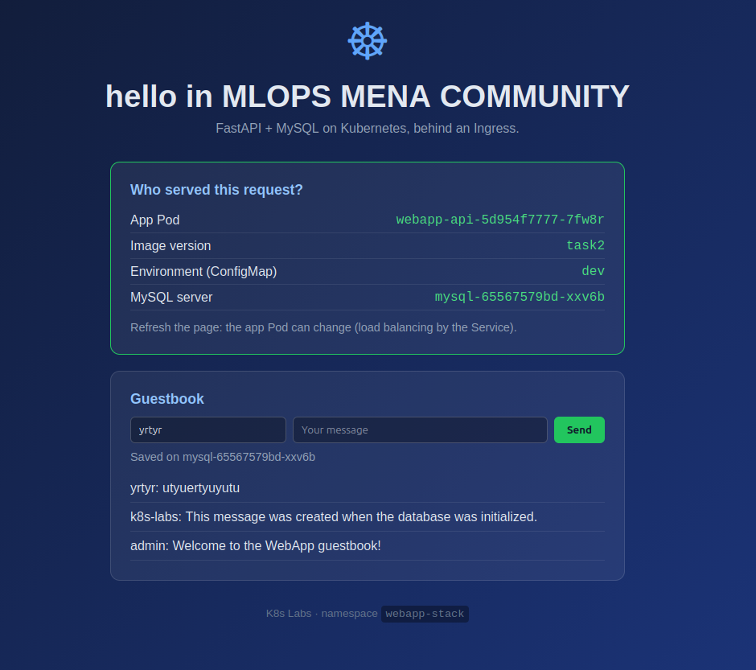

# Task 2: FastAPI + MySQL on Kubernetes

## 1. Namespace, Secret & ConfigMap

Created the `webapp-stack` namespace, `mysql-secret` for database credentials, and `webapp-config` for application settings.

## 2. Persistent Storage

Created a 2Gi PersistentVolume (`mysql-pv`) and PersistentVolumeClaim (`mysql-pvc`) for MySQL data storage.

## 3. MySQL Deployment

Deployed one MySQL replica with persistent storage and a ClusterIP Service on port `3306`.

## 4. FastAPI Deployment

Deployed two FastAPI replicas connected to MySQL through Kubernetes Services.

## 5. Ingress Configuration

Enabled the Nginx Ingress Controller and configured `webapp-ingress` to route HTTP traffic to the FastAPI Service.

## 6. Guestbook Application

Accessed the FastAPI guestbook through the Ingress Controller at `http://localhost:8080`.

